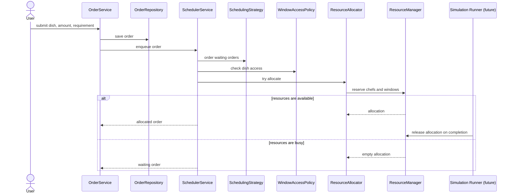

# 系统架构

项目不设置 Maven 标准源码根或额外架构层。`src/` 中的一级目录就是 Java 包，各实现类直接放在对应模块。

## 模块职责

- `user`：用户继承类型、用户组、用户 Repository 契约与窗口访问策略。
- `menu`：菜品类型和不可变菜品配置。
- `order`：订单及状态、资源需求、订单服务与 Repository 契约、工作量计算接口和拒绝异常。
- `resource`：窗口、厨师、资源分配结果、资源分配/管理接口与窗口 Repository。
- `scheduling`：调度服务和调度顺序策略接口。
- `simulation`：仿真时钟接口。
- `config`：默认菜单、窗口和厨师资源配置。
- `CanteenApplication.java`：默认包中的启动入口。

应用契约通过类型引用协作：订单模块使用用户、菜品与调度接口；调度模块使用订单和资源接口；资源模块依赖订单与菜品；配置模块装配用户组、菜品和窗口对象。领域对象不依赖 Repository 实现。当前只定义接口，不实现业务调度或持久化。

## 核心对象关系

## 下单到完成的预期协作

## 默认容量

`config.CanteenConfiguration.defaults()` 定义 8 个窗口和 45 名厨师：牛肉面 4 窗口按 3/3/2/2 分配；馄饨 2 窗口各 10 人；黄焖鸡 10 人；湘里湘外 5 人。湘里湘外要求 `user.UserGroup.HUNAN` 成员资格，其余菜品不要求专属用户组。
