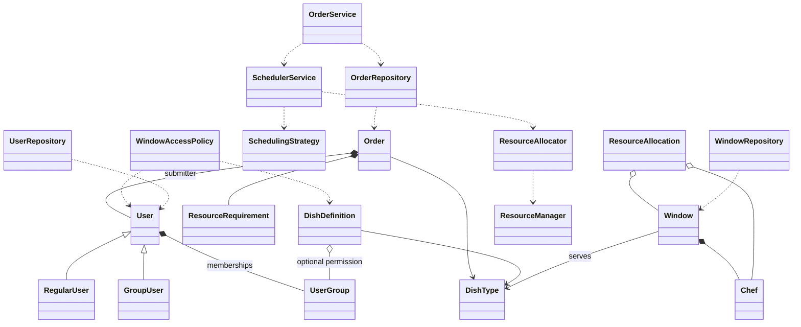
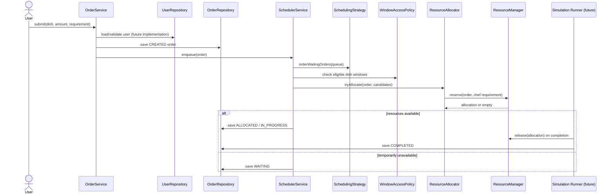

# 系统架构

## 分层与职责

`domain` 保存不依赖框架的领域对象；`application` 定义用例服务策略与资源访问契约；`repository` 隔离数据存储；`config` 集中默认资源；`infrastructure` 由后续实现具体适配器。依赖方向由应用层指向领域对象和端口，领域层不调用应用层或 Repository。

`OrderService` 接收合法订单请求并保存订单、交给 `SchedulerService`；调度器通过 `SchedulingStrategy` 排定待处理订单，通过 `WindowAccessPolicy`筛选有权使用的窗口，再通过 `ResourceAllocator` / `ResourceManager`预留资源。实际执行器未来根据仿真时钟推进状态并释放资源。本阶段只有契约，没有完成调度和持久化实现。

## 核心对象关系

订单、需求、用户和资源结构对外不可变；资源状态与订单状态的生命周期转换应由应用层服务实现，不向调用者暴露字段修改。

## 下单至完成时序

## 默认容量

`CanteenConfiguration.defaults()` 是唯一默认资源清单：牛肉面 4 窗口、厨师分布 3/3/2/2；馄饨 2 窗口各 10 人；黄焖鸡 1 窗口 10 人；湘里湘外 1 窗口 5 人。总计 8 窗口、45 名厨师。湖南组是湘里湘外的唯一专属组要求，其余菜品为公共窗口。
